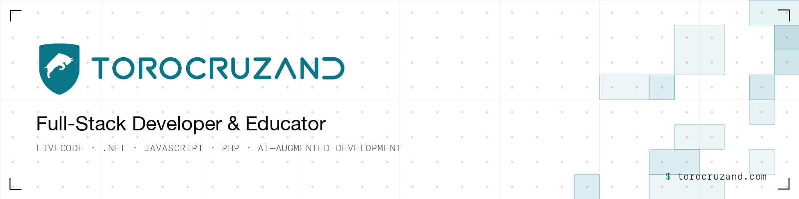
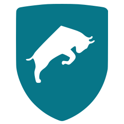

<picture>
  <source media="(prefers-color-scheme: dark)" srcset="assets/github-banner-dark.png">
  
</picture>

  
  
  

## Hi, I'm Andrés

I'm a **full-stack software developer and educator** with **14 years** of experience designing, building and maintaining cross-platform, scalable applications for desktop, web and mobile. Today I'm a Software Developer at **[LiveCode Ltd](https://livecode.com/)**, contributing to the LiveCode ecosystem with an international, distributed team.

I came to software through teaching. I hold a **degree in Education, specialising in Mathematics and Physics**, and taught mathematics before moving into development at the University of Holguín, where I kept teaching while I built its academic systems. That background still shapes how I work: clear code, clear documentation, and helping the people around me grow.

- **Specialty:** LiveCode, plus .NET, PHP and modern JavaScript for everything around it
- **How I work:** end-to-end ownership, from requirements and estimates to delivery and support
- **Teaching:** software development courses, mentoring and code review, and technical writing
- **Currently:** AI-augmented development, using AI tools as a force multiplier on a solid engineering foundation

## Experience

| Period | Role | Where |
|---|---|---|
| 2024 — present | **Software Developer** | LiveCode Ltd · remote |
| 2021 — 2024 | **Software Developer** | Severin Studio S.L. · remote |
| 2019 — 2021 | **Software Developer** | SifiSoft |
| 2016 — 2019 | **Programmer & Professor** | CESOFTAD, University of Holguín |
| 2014 — 2016 | **Mathematics Teacher** | José Martí Teacher Training College |

**Education:** Bachelor of Education, Mathematics and Physics (2014)

## Tech stack

<table>
  <tr>
    <td><strong>Specialty</strong></td>
    <td>
      &nbsp;
      
    </td>
  </tr>
  <tr>
    <td><strong>Languages</strong></td>
    <td><picture><source media="(prefers-color-scheme: dark)" srcset="https://skillicons.dev/icons?theme=light&perline=12&i=js%2Cts%2Cphp%2Ccs%2Cdart%2Crust%2Cc%2Ccpp%2Chtml%2Ccss"></picture></td>
  </tr>
  <tr>
    <td><strong>Frameworks</strong></td>
    <td><picture><source media="(prefers-color-scheme: dark)" srcset="https://skillicons.dev/icons?theme=light&perline=12&i=dotnet%2Cvue%2Cangular%2Castro%2Ctailwind%2Cflutter%2Cnodejs%2Cwordpress"></picture></td>
  </tr>
  <tr>
    <td><strong>Data &amp; cloud</strong></td>
    <td><picture><source media="(prefers-color-scheme: dark)" srcset="https://skillicons.dev/icons?theme=light&perline=12&i=mysql%2Csqlite%2Cfirebase"></picture></td>
  </tr>
  <tr>
    <td><strong>Tools</strong></td>
    <td><picture><source media="(prefers-color-scheme: dark)" srcset="https://skillicons.dev/icons?theme=light&perline=12&i=git%2Cgithub%2Cvscode%2Cvisualstudio%2Candroidstudio"></picture></td>
  </tr>
  <tr>
    <td><strong>More</strong></td>
    <td>
      &nbsp;
      &nbsp;
      &nbsp;
      &nbsp;
      &nbsp;
      
    </td>
  </tr>
  <tr>
    <td><strong>AI-augmented</strong></td>
    <td>
      &nbsp;
      &nbsp;
      &nbsp;
      
    </td>
  </tr>
</table>

## Open source

| Project | What it does |
|---|---|
| [**PhotonJSON**](https://github.com/dtbyte-Ltd/PhotonJSON/) | JSON encode/decode library written in pure LiveCode Script, with no externals |
| [**TinyColor for LiveCode**](https://github.com/dtbyte-Ltd/TinyColor) | Port of the TinyColor v1.4.2 colour micro-framework to LiveCode |
| [**DevGuides**](https://github.com/dtbyte-Ltd/DevGuides) | IDE extension that helps LiveCode developers lay out user interfaces |
| [**touchGestures**](https://github.com/dtbyte-Ltd/touchGestures) | Library for handling finger gestures on touch screens |
| [**Drag Drop Files into IDE**](https://github.com/dtbyte-Ltd/frlDragDropFilesIntoIDE/) | Drag images, video, SVG and text into any open LiveCode IDE window |
| [**ipapi-lc**](https://github.com/torocruzand/ipapi-lc) | LiveCode Script library for IP address lookups (ISP, geolocation, risk) via ipquery.io |
| [**bugzilla-mcp**](https://github.com/torocruzand/bugzilla-mcp) | Model Context Protocol server that lets AI agents search, create and update Bugzilla bugs |

## Let's connect

I'm always open to discussing new projects, creative ideas, or opportunities to be part of your vision. Find my work, CV and contact details at **[torocruzand.com](https://torocruzand.com/)**.

  

